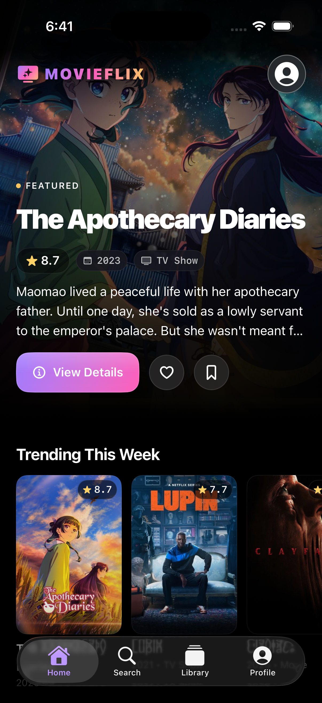

# MovieFlix

MovieFlix is a full-stack movie and TV discovery app: a SwiftUI iOS client backed by an ASP.NET Core REST API, with TMDB as the source of film and TV metadata.

<p align="center">
  
  <br />
  <sub>SwiftUI V2 home screen — featured hero, library actions, and discovery rails.</sub>
</p>

> **Project status:** The ASP.NET Core backend and the SwiftUI V2 client are both under active development. Features and structure may change. `frontend/v1` is the original client, kept for reference; `frontend/v2` is the current client.

## Backend features

- **Movies and TV from TMDB** — search (multi/movie/tv), trending/feeds, details, seasons/episodes with metadata from TMDB.
- **Episode-level watch tracking** — per-episode progress, next-episode resolution, and Continue Watching across movies and TV.
- **REST API** — versioned endpoints under `/api/v1`; the API reports its supported versions via the `api-supported-versions` response header.
- **User accounts and authentication** — ASP.NET Core Identity with password hashing, JWT-based login, refresh-token rotation, and role-based authorization.
- **Library parity** — favorites, watchlist, ratings (1–5 with community average), reviews, collections, watch history, search history, and user preferences for both movies and TV.
- **Database persistence** — Entity Framework Core with SQLite by default (Postgres configurable).
- **TMDB resilience and caching** — automatic retries, timeouts, circuit breaker, and output caching for TMDB-backed responses.
- **Rate limiting** — a global per-client request budget plus a stricter limit on the login, register, and refresh endpoints (configurable).
- **Health checks** — `/health`, `/health/live`, `/health/ready` endpoints.
- **Structured logging** — request/response logging via Serilog writing structured events to the console.
- **CORS** — configurable allowed origins for a future web front-end.
- **Validation and error handling** — consistent Problem Details responses for API errors, including invalid input and missing records.
- **Authorization** — protected operations using JWT authentication and role-based access rules.
- **Automated tests** — 76 hermetic integration/unit tests using xUnit and an isolated SQLite database (no external network calls, fake TMDB service).
- **One clean schema** — a single `InitialMediaSchema` EF Core migration; the database is recreated from scratch and media types are stored as lowercase `movie`/`tv`.

See [docs/API_CONTRACT.md](docs/API_CONTRACT.md) for the complete client-facing contract and [docs/openapi.json](docs/openapi.json) for the OpenAPI document.

## iOS client features

- **Discovery-first home** — a featured hero with favorite/watchlist actions and rails for trending, popular movies, popular TV, in theatres, and airing today.
- **Search and genre discovery** — multi/movie/TV search, trending windows, genre chips, and filtered discovery results.
- **Full library parity** — favorites, watchlist, ratings, reviews, collections, watch history, Continue Watching, search history, and preferences.
- **Rich media details** — backdrops, ratings, overviews, cast and key crew, similar titles, seasons/episodes, reviews, and episode-level progress.
- **Accounts** — register, sign in, session restore, profile refresh, and sign out. JWT access tokens and rotating refresh tokens are handled transparently.
- **Design system** — adaptive light/dark theme, semantic color/typography/spacing/motion tokens, and reusable components.
- **Resilient UX** — loading skeletons, empty/error states, partial-failure banners, pull-to-refresh, toasts, and optimistic library updates that roll back on failure.
- **Accessibility** — VoiceOver labels and hints, Dynamic Type-friendly system text styles, and reduce-motion support.

## Tech stack

| Area | Technologies |
| --- | --- |
| iOS client | Swift 6, SwiftUI, Observation, Swift Testing (iOS 26.2) |
| Client architecture | MVVM, protocol-based repositories, dependency injection via `AppContainer` |
| Client security | Keychain session storage, JWT access tokens, rotating refresh tokens |
| Client images | Custom `URLSession` pipeline with `NSCache`, in-flight deduplication, and ImageIO downsampling |
| Backend | C#, ASP.NET Core Web API, **.NET 9** |
| Database | SQLite (default), PostgreSQL (configurable) |
| Data access | Entity Framework Core |
| Authentication | ASP.NET Core Identity, JWT bearer authentication, refresh tokens, role-based authorization |
| External movie data | [The Movie Database (TMDB)](https://www.themoviedb.org/) |
| Resilience | Polly via `Microsoft.Extensions.Http.Resilience` (retry, timeout, circuit breaker) |
| Caching | ASP.NET Core output caching |
| API documentation | Swagger / OpenAPI |
| Testing | xUnit + `WebApplicationFactory` (backend), Swift Testing (iOS) |
| Logging | Serilog (structured console logging), `OSLog` on iOS |
| API versioning | Asp.Versioning (v1, reported on responses) |
| Rate limiting | ASP.NET Core rate limiting |
| Health checks | ASP.NET Core health checks |
| Containers | Multi-stage Docker image, non-root runtime, `docker-compose` |
| Deployment | Docker, docker-compose, GitHub Actions CI |

## Repository structure

``` text
MovieFlix-Swift-ASP.NET/
├── frontend/
│   ├── v1/                      # Original SwiftUI client (legacy)
│   └── v2/
│       ├── MovieFlix/
│       │   ├── App/             # App entry point and composition root
│       │   ├── Core/            # Networking, auth, models, repositories, images
│       │   ├── DesignSystem/    # Theme tokens and reusable components
│       │   └── Features/        # Home, Search, Library, Detail, Collections, Profile, Auth
│       ├── MovieFlixTests/      # Swift Testing unit tests
│       └── Config/              # xcconfig and Info.plist environment configuration
├── backend/
│   ├── MovieFlix.Api/           # ASP.NET Core Web API
│   └── MovieFlix.Api.Tests/     # xUnit integration and unit tests
├── docs/                        # API contract, operations guide, screenshots
├── scripts/                     # Smoke-test helpers
└── docker-compose.yml
```

## Architecture at a glance

``` text
SwiftUI View
    -> @Observable view model
        -> repository protocol
            -> APIClient (typed endpoints, Problem Details mapping)
                -> ASP.NET Core controller
                    -> scoped service
                        -> EF Core -> SQLite / PostgreSQL
                        -> ITmdbService -> TMDB (resilience + caching)
```

Authentication is token-based end to end:

``` text
Login / Register -> access token + rotating refresh token -> Keychain
Protected request -> 401 -> single-flight refresh -> replay original request
```

## How it fits together

``` text
SwiftUI app
    |
    | HTTP requests / JSON
    v
ASP.NET Core REST API
    |                 \
    v                  v
SQLite/Postgres DB    TMDB API
(users, media cache,
 favorites, watchlist,
 ratings, reviews,
 collections, history,
 episode progress)
```

## Engineering practices

### Backend

- **Layered, testable design** — thin controllers, scoped services behind interfaces, DTOs, a dedicated mapping layer, and EF Core behind the service boundary.
- **Deterministic time** — `TimeProvider` is injected so token lifetimes, lockouts, and tests are reproducible.
- **Security by default** — ASP.NET Core Identity password hashing and lockout, strict JWT validation, refresh-token rotation/revocation, role-based authorization, and secrets kept in user-secrets or environment variables (never in git).
- **Consistent API behavior** — `/api/v1` versioning, Problem Details with `traceId`, validation error dictionaries, correct status codes, pagination, and idempotent `PUT`/`DELETE` membership writes.
- **Resilience and caching** — typed TMDB `HttpClient` with retry + jitter, attempt/total timeouts, and a circuit breaker; per-endpoint output-cache policies; opt-in background cache warm-up.
- **Production readiness** — Serilog structured logs, live/ready/database health checks, rate limiting with `Retry-After`, response compression, forwarded headers, CORS, HTTPS redirection, and HSTS outside development.
- **Data integrity** — unique indexes, foreign keys, a single clean migration, value converters for lowercase media types, and a provider switch between SQLite and PostgreSQL.
- **Hermetic tests** — `WebApplicationFactory` runs the real API pipeline against in-memory SQLite, a fake TMDB service, and a deterministic clock. No network access, secrets, or developer database required.
- **Delivery hygiene** — multi-stage non-root Docker image with a health probe, `docker-compose` for local/production-like runs, and GitHub Actions CI with NuGet caching, least-privilege permissions, and `-warnaserror`.

### iOS client

- **Layered SwiftUI + MVVM** — feature folders, `@Observable` view models that own screen state, protocol-based repositories, and a single `AppContainer` composition root. Views stay declarative; business logic stays testable.
- **Swift 6 concurrency** — complete strict-concurrency checking, MainActor default isolation for UI, explicitly `nonisolated` networking/domain types, and `Sendable` models. Independent home feeds load concurrently with structured concurrency.
- **Typed networking** — `APIEndpoint` values describe every request; one `APIClient` handles headers, tokens, decoding, Problem Details mapping, transport errors, and `OSLog` timing.
- **Secure auth lifecycle** — Keychain storage with an in-memory cache (`AfterFirstUnlockThisDeviceOnly`), expiry-aware session restore, single-flight token refresh on `401`, automatic request replay, and no sign-out on transient network failures.
- **Efficient images** — a custom pipeline with two `URLSession` caches, `NSCache`, in-flight request deduplication, and ImageIO downsampling to the rendered size.
- **Design system** — semantic adaptive colors (dark-first OLED), system text styles, spacing/radius/motion tokens, reduce-motion support, and reusable components instead of ad-hoc styling.
- **Accessible, resilient UX** — VoiceOver labels and hints, Dynamic Type-friendly typography, loading skeletons, empty/error states, partial-failure banners, pull-to-refresh, toasts, and optimistic library toggles with rollback.
- **Configuration and safety** — API and image URLs come from `.xcconfig`/Info.plist, local overrides stay git-ignored, Release builds require HTTPS, and the debug-only self-signed certificate trust is scoped to the configured host and compiled out of Release.
- **Unit tests** — 77 Swift Testing tests cover the API client, session/refresh flow, repositories, and view models using in-memory fakes.

## Run the backend locally

### Prerequisites

- [.NET 9 SDK](https://dotnet.microsoft.com/download/dotnet/9.0)
- A TMDB API key (read token) for endpoints that use TMDB
- Git

### 1. Clone and configure secrets

```bash
git clone https://github.com/LihinduPerera/MovieFlix-Swift-ASP.NET.git
cd MovieFlix-Swift-ASP.NET/backend/MovieFlix.Api
dotnet user-secrets set "Tmdb:AccessToken" "<your-tmdb-read-token>"
dotnet user-secrets set "Jwt:Key" "<a-strong-random-key>"
```

### 2. Build and run

```bash
cd ../..
dotnet build backend/MovieFlix.sln
dotnet run --project backend/MovieFlix.Api/MovieFlix.Api.csproj
```

The launch profiles serve `http://localhost:5122` and
`https://localhost:7014`; Swagger UI is at `/swagger` in Development. On first
startup the app applies the single `InitialMediaSchema` migration and seeds the
`Admin`/`User` roles. To recreate the database from scratch, stop the API and
delete `MovieFlix.db` (plus `-wal`/`-shm`); startup recreates it. See
[Database operations](docs/OPERATIONS.md#4-database-sqlite-vs-postgresql) for
explicit `dotnet ef database update` steps.

### 3. Test the backend

```bash
dotnet test backend/MovieFlix.sln
```

The suite runs in the `Testing` environment against an isolated SQLite
database with a fake TMDB service; it requires no secrets and makes no external
network calls. Expected result: **76 passed, 0 failed**.

See [docs/OPERATIONS.md](docs/OPERATIONS.md) for full configuration (Postgres, Docker, env vars, migrations).

## Run the iOS app

### Prerequisites

- Xcode 26 or newer (iOS 26.2 SDK)
- A running MovieFlix backend, or a different API URL in `frontend/v2/Config/Debug.xcconfig`

### Open and run

```bash
open frontend/v2/MovieFlix.xcodeproj
```

Select the **MovieFlix** scheme and an iPhone/iPad simulator, then press <kbd>⌘R</kbd>.

The API and image base URLs are injected through `frontend/v2/Config/*.xcconfig`.
Use `Config/Local.xcconfig` (git-ignored) for machine-specific overrides. Debug
builds allow the development HTTP server; Release builds require HTTPS.

### Test the iOS client

```bash
xcodebuild test \
  -project frontend/v2/MovieFlix.xcodeproj \
  -scheme MovieFlix \
  -destination 'platform=iOS Simulator,name=iPhone 17 Pro'
```

Expected result: **77 tests passing**.

## API overview (high level)

Base path: `/api/v1`. Key areas: auth, search/discovery, media details (movies/TV + seasons/episodes), `/me` profile/library (favorites/watchlist/ratings/history/continue/reviews/collections/search-history/preferences), admin media refresh, health. Full details in [docs/API_CONTRACT.md](docs/API_CONTRACT.md).

## Documentation

- [API contract](docs/API_CONTRACT.md) — routes, request/response shapes, status codes, and caching behavior.
- [OpenAPI document](docs/openapi.json) — machine-readable API definition.
- [Operations guide](docs/OPERATIONS.md) — configuration, secrets, database providers, Docker, health checks, logging, and rate limiting.
- [Backend build progress](docs/BUILD_PROGRESS.md) — historical implementation log and current backend status.

## Acknowledgements

- [The Movie Database (TMDB)](https://www.themoviedb.org/) for movie/TV data. This product uses the TMDB API but is not endorsed or certified by TMDB.

**Built while learning SwiftUI, C#, and ASP.NET Core.**
